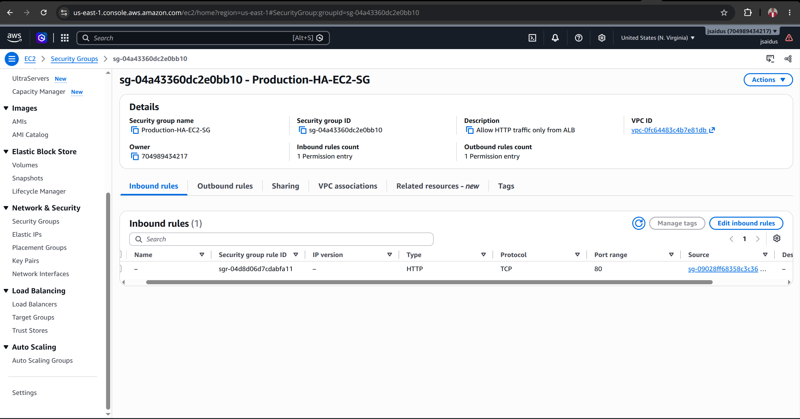
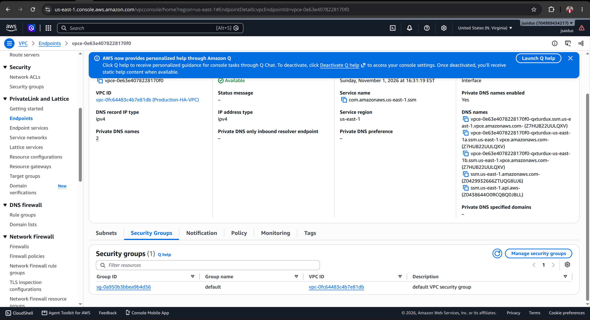
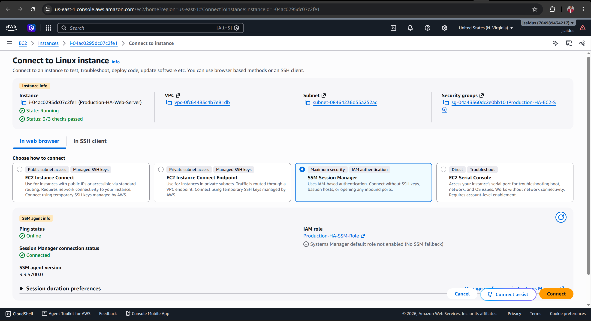
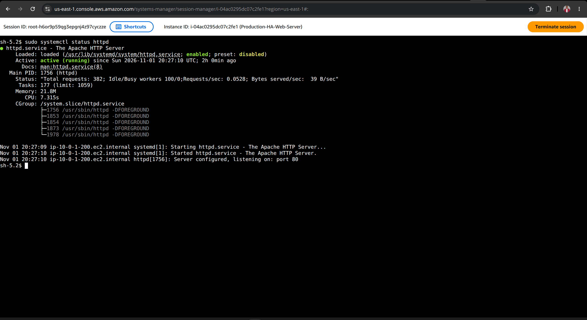
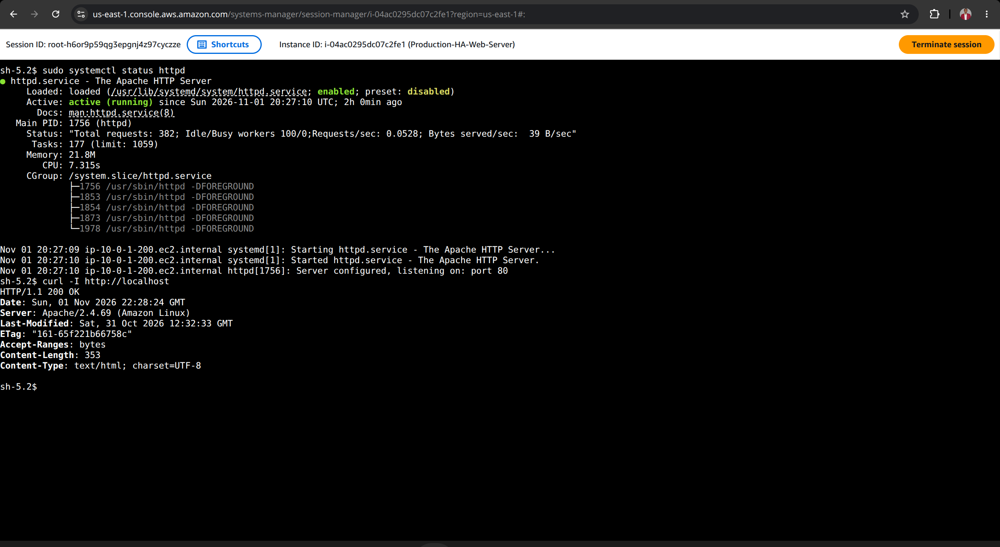
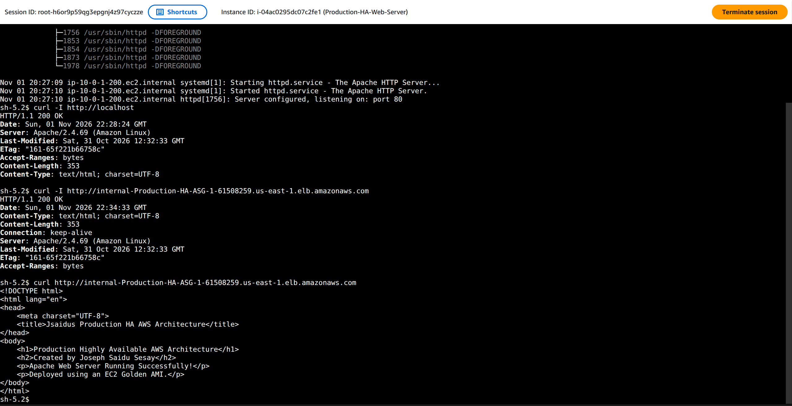
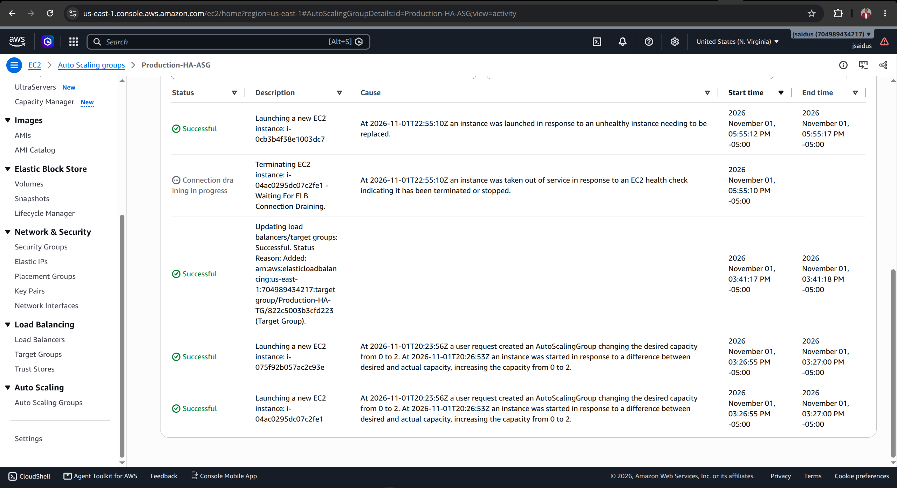
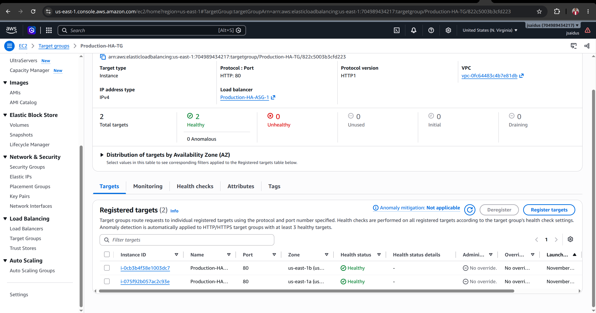

# AWS Production High Availability Architecture

**A hands-on AWS infrastructure project featuring private application servers, internal load balancing, Systems Manager access, a Golden AMI, and EC2 Auto Scaling recovery.**

**Built by:** Joseph Saidu Sesay  
**Region:** US East (N. Virginia), `us-east-1`  
**Project period:** October 30–November 1, 2026  
**Environment:** AWS, Amazon Linux 2023, Apache HTTP Server

## 1. Project overview

This project explores how to deploy and operate a highly available web tier on AWS while keeping application instances off the public internet. I built a custom VPC environment, configured security groups and private connectivity, deployed an Apache web server, created a reusable EC2 Golden AMI, and used an Auto Scaling group behind an **internal** Application Load Balancer (ALB).

I also tested operational access using AWS Systems Manager Session Manager, investigated connectivity and health-check issues, and observed Auto Scaling replace an unhealthy instance. After recovery, the target group showed **two healthy targets across two Availability Zones**, and an HTTP request to the internal ALB returned **`200 OK`**.

> **Scope note:** “Production” is the project name and design goal; this is a hands-on lab, not a claim of a live production service. The ALB is **internal**, so the application is not publicly reachable through its ALB DNS name.

## 2. Architecture

```text
                     AWS Region: us-east-1
             +----------------------------------+
             |         Production-HA-VPC        |
             |                                  |
             |   Private networking / routing   |
             |                |                 |
             |       Internal ALB (HTTP:80)     |
             |                |                 |
             |       Production-HA-TG           |
             |            /       \             |
             |           /         \            |
             |    Private EC2   Private EC2     |
             |       AZ A          AZ B         |
             |       Apache       Apache        |
             |           \         /            |
             |        Production-HA-ASG         |
             |      Desired: 2; Min: 2; Max: 4 |
             |                                  |
             |  IAM role + SSM Agent            |
             |  Interface VPC endpoints         |
             +----------------------------------+

     Administrative access: AWS Systems Manager Session Manager
     Web testing: curl from a network-connected EC2 session
```

**Key architectural choices:**

- **Private EC2 instances:** No public IPv4 address is required for the application tier.
- **Internal ALB:** Distributes HTTP requests to healthy targets inside the VPC.
- **Two Availability Zones:** Spreads web-serving capacity across separate AZs.
- **Auto Scaling group:** Maintains desired capacity and replaces unhealthy instances.
- **Golden AMI:** Supplies a preconfigured Apache web-server image for repeatable launches.
- **Session Manager:** Provides shell access without opening inbound SSH ports.
- **VPC interface endpoints:** Support private connectivity to AWS Systems Manager services.

## 3. AWS services and tools

| Component | Purpose |
|---|---|
| Amazon VPC, subnets, route tables | Isolated network foundation |
| Amazon EC2 | Linux web-server compute |
| Amazon Linux 2023 | Server operating system |
| Apache HTTP Server (`httpd`) | Serves the sample application |
| EC2 Golden AMI | Reusable, preconfigured server image |
| Application Load Balancer | Internal HTTP traffic distribution |
| Target group and health checks | Registers and monitors backend servers |
| EC2 Auto Scaling | Desired capacity and instance replacement |
| IAM role and instance profile | Permissions for Systems Manager |
| AWS Systems Manager Session Manager | Private administrative access |
| VPC interface endpoints and security groups | Private service connectivity and traffic controls |
| `systemctl`, `curl`, Linux shell | Service verification and troubleshooting |

## 4. Implementation walkthrough

### Step 1 — Build the VPC network

Created the project VPC and subnet layout across multiple Availability Zones. Configured route tables and security boundaries for the intended private application architecture.

**Validation:** Reviewed VPC, subnet, and routing configuration in the AWS console.

### Step 2 — Configure security groups

Configured an EC2 security group intended to accept HTTP on **TCP 80 from the ALB security group**, rather than from the entire internet. Configured the VPC endpoint security group for **TCP 443 from the relevant private instances/security group**.

**Validation:** Reviewed inbound/outbound rules and endpoint security-group associations.

### Step 3 — Prepare Apache on Amazon Linux

Installed and configured the Apache HTTP Server on the source EC2 instance, enabled the service, and prepared a simple HTML test page. Created a Golden AMI for subsequent Auto Scaling launches.

Useful verification commands:

```bash
sudo systemctl status httpd
sudo systemctl is-enabled httpd
curl -I http://localhost
curl http://localhost
```

The captured test shows `httpd` **active (running)** and `curl -I http://localhost` returning **`HTTP/1.1 200 OK`**.

### Step 4 — Set up IAM and Session Manager

Associated an EC2 IAM role with Systems Manager permissions and configured interface endpoints for private SSM connectivity. Investigated cases where the SSM Agent was running but the instance was not yet connected.

**Validation:** The later console screenshot shows **SSM Agent: Online** and **Session Manager connection status: Connected**. An interactive Session Manager shell was used to check Apache.

### Step 5 — Configure target group and internal ALB

Created `Production-HA-TG` for **HTTP port 80** and connected it to an **internal** Application Load Balancer. Configured target health checks to verify the web service before routing traffic.

**Validation:** The target group ultimately displayed **2 total targets, 2 healthy, 0 unhealthy**.

### Step 6 — Create the Auto Scaling group

Created `Production-HA-ASG` using a launch configuration/template based on the prepared server image.

Captured capacity settings:

| Setting | Value |
|---|---:|
| Minimum capacity | 2 |
| Desired capacity | 2 |
| Maximum capacity | 4 |
| Instance type shown | `t3.micro` |

Two instances were shown healthy and in service in separate Availability Zones.

### Step 7 — Validate application responses

From a connected EC2 Session Manager shell, ran:

```bash
curl -I http://localhost
curl -I http://<internal-alb-dns-name>
curl http://<internal-alb-dns-name>
```

**Observed results:** Both the local Apache endpoint and internal ALB returned **`HTTP/1.1 200 OK`**. The ALB response contained the project HTML page identifying the Apache web server and Golden AMI.

### Step 8 — Test recovery / self-healing

Observed an instance being taken out of service and Auto Scaling launching a replacement. AWS Auto Scaling activity reported a successful replacement launch after the instance was marked unhealthy or stopped. After recovery, the target group again showed **two healthy instances in separate AZs**.

**Important distinction:** These observations demonstrate automated instance replacement and recovery of healthy target capacity. They do **not**, by themselves, establish zero downtime or measured recovery time.

## 5. Troubleshooting journal — October 30 to November 1

The project was developed iteratively, with screenshots captured throughout the build. The items below are grounded in the available project screenshots and prior troubleshooting notes. Where the exact cause is not fully established, it is labeled accordingly.

| Challenge | What was observed | Investigation / response | Outcome |
|---|---|---|---|
| Initial EC2 access | An SSH connection attempt timed out when a private address was used from an unsuitable network path | Reviewed public vs. private IP addressing and access method | Subsequent access was established through an appropriate connection method |
| ALB target health | Initial target health checks failed / timed out | Reviewed Apache service, port 80, target group, and ALB-to-EC2 security group access | Target group later showed 2 healthy targets |
| SSM IAM permissions | Screenshots recorded no instance profile and IAM role attached but not yet connected | Reviewed IAM instance role and managed SSM policy | SSM connection was later successful |
| SSM private DNS / endpoints | A VPC endpoint private DNS error was captured, followed by endpoint creation and availability | Reviewed SSM interface endpoints, private DNS, and HTTPS endpoint security group | Later SSM Agent status was Online / Connected |
| Apache availability | Needed to confirm Apache was listening and serving HTTP | `sudo systemctl status httpd`; `curl -I http://localhost` | `httpd` running; HTTP 200 OK |
| Internal ALB availability | Needed to confirm traffic through the load balancer | `curl -I` and `curl` against internal ALB DNS | HTTP 200 OK and expected HTML |
| EC2 instance failure/replacement | Auto Scaling activity reported an instance being removed and replacement launched | Reviewed ASG Activity, Instance management, and target group | Replacement healthy; 2 healthy targets across AZs |

**Root-cause discipline:** A screenshot of an error is evidence of the symptom, not automatically proof of its root cause. The precise cause and fix for the original Apache/health-check and private DNS problems should be expanded only if supported by the original October 30–31 screenshots or command history.

## 6. Screenshot evidence

The following screenshot folders organize the build, errors, corrections, and validation. Paths are relative to this repository.

| Folder | Evidence |
|---|---|
| `screenshots/02-security-iam/` | EC2 and VPC endpoint security groups; IAM policy and roles |
| `screenshots/03-ec2-instances/` | EC2 configuration and IAM role association |
| `screenshots/05-auto-scaling/` | ASG setup, healthy instances, detachment/replacement, recovery activity |
| `screenshots/06-ssm-endpoints/` | Endpoint creation, private DNS, SSM errors, SSM connection |
| `screenshots/07-testing-validation/` | Target health checks, Apache running, localhost and ALB HTTP 200 tests |

### Selected screenshots

**EC2 security group — ALB-to-instance HTTP restriction**



**SSM endpoint — private DNS and endpoint configuration**



**SSM connected to private EC2**



**Apache running**



**Apache localhost returns HTTP 200**



**Internal ALB returns HTTP 200**



**Auto Scaling replacement activity**



**Recovered target group — two healthy targets**



> Some screenshot names are based on the organization steps performed during the project. Before publishing, verify that every linked file exists and that no screenshot exposes credentials, session tokens, or unnecessary account identifiers.

## 7. What I learned

- How private subnet routing, security groups, and interface endpoints affect management access.
- Why a running EC2 instance is not the same as a healthy application target.
- How to verify Apache locally before troubleshooting the ALB.
- How IAM instance profiles and SSM Agent connectivity work together.
- How to use a Golden AMI to launch consistent application instances.
- How Auto Scaling responds when an instance becomes unhealthy.
- How to collect evidence that supports a technical troubleshooting narrative.

## 8. Future improvements

- Automate infrastructure provisioning using **Terraform**.
- Add **CloudWatch** dashboards, alarms, and access logs.
- Configure **HTTPS/TLS** for applicable internal clients and endpoints.
- Run a repeatable, timed failover test and measure recovery duration.
- Implement a controlled CI/CD pipeline for web content or AMI updates.
- Review IAM and endpoint policies for least-privilege access.
- Add cost estimates and automated cleanup for lab resources.

## 9. Cost and cleanup

AWS resources such as EC2 instances, load balancers, interface VPC endpoints, storage, and data transfer may incur charges. After capturing evidence, review **Billing and Cost Management** and remove unneeded resources. An Auto Scaling group may recreate EC2 instances unless its desired capacity is reduced or the group is deleted first.

## 10. Author

**Joseph Saidu Sesay**  
Cloud Engineering | AWS | Linux | Networking | DevOps

*This repository documents a practical AWS learning project, including successful outcomes and troubleshooting lessons.*
